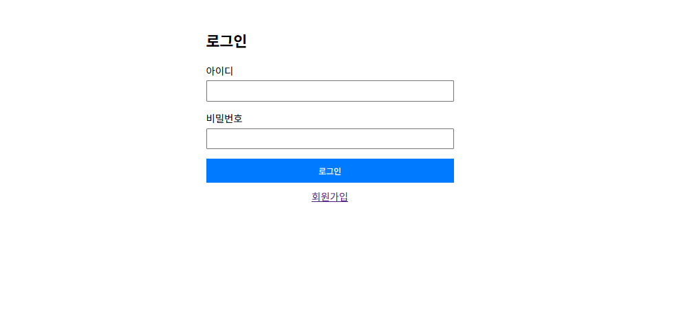
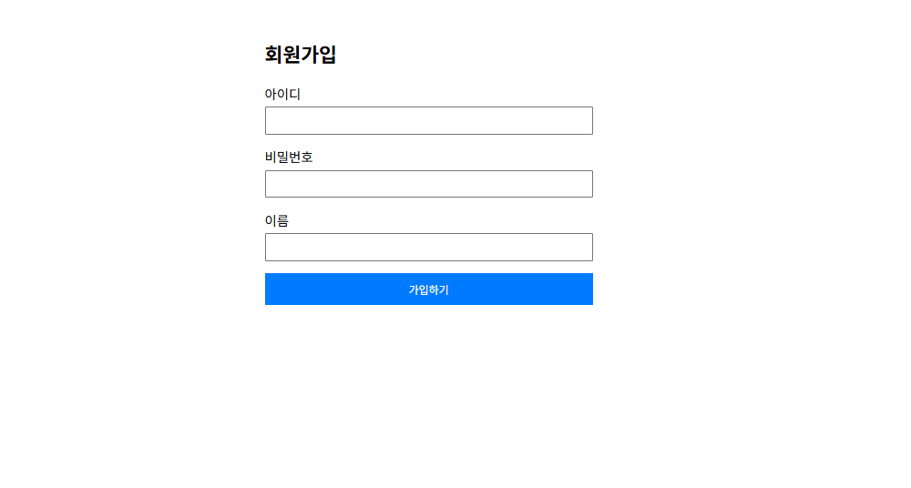
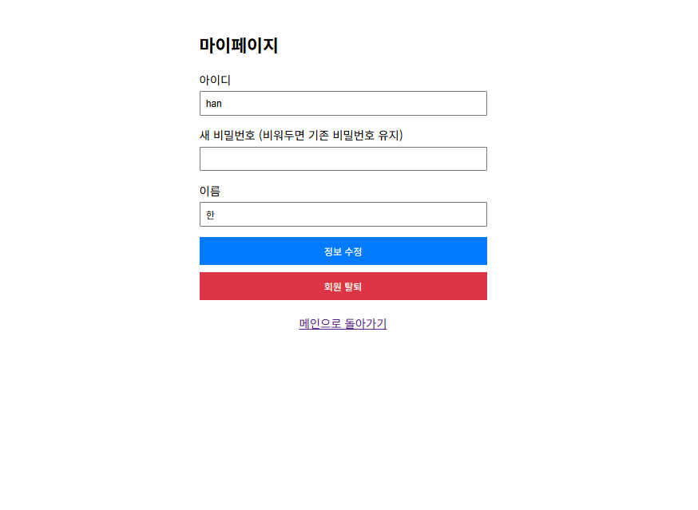
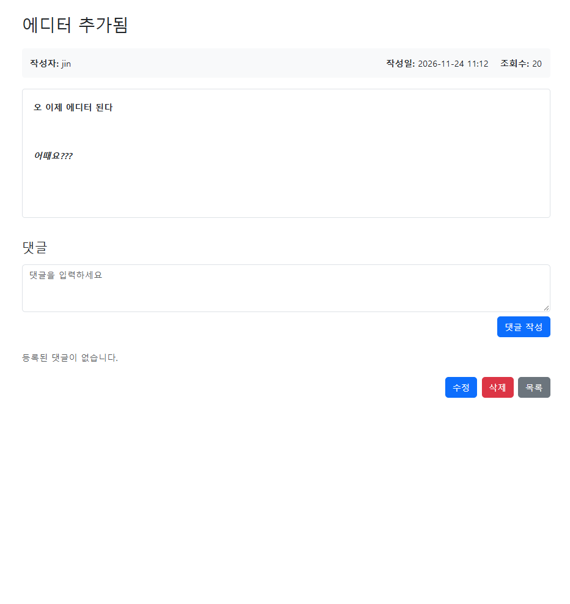
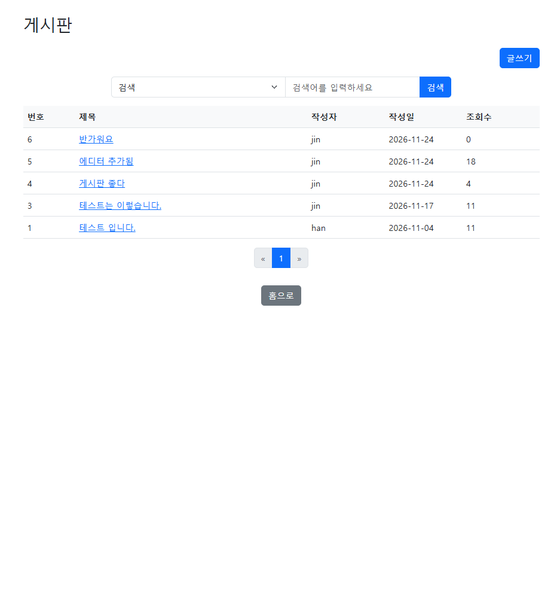

# Spring Boot Basic -- 회원 관리 & 게시판

Spring Boot와 Spring Security, MyBatis, Thymeleaf, Oracle을 활용해
구현한 웹 애플리케이션 실습 프로젝트입니다.

회원가입과 로그인부터 회원 정보 관리, 게시판 CRUD, 조회수 처리,
페이지네이션까지 단계적으로 구현하며 Spring 기반 웹 애플리케이션의 기본
구조와 데이터 처리 흐름을 학습했습니다.

## 레포 구성

| 폴더 | 단계 | 내용 |
|---|---|---|
| `springboot_basic` | Day 1 | Spring Security 회원가입 · 로그인 · 마이페이지 · 정보 수정 · 회원 탈퇴 |
| `springboot_basic_ver2` | Day 1 + Day 2 (업그레이드) | 회원 관리 + 게시판 CRUD + 조회수 + **페이지네이션 · 검색** |

> 이 README는 `springboot_basic_ver2` 기준으로 작성했습니다.

------------------------------------------------------------------------
## 실행 결과

<table>
  <tr>
    <td></td>
    <td></td>
  </tr>
  <tr>
    <td></td>
    <td></td>
  </tr>
  <tr>
    <td></td>
    <td></td>
  </tr>
</table>

**[▶  시연 영상 보기 (MP4)](./테스트영상.mp4)**
## 1. 프로젝트 개요

### 주요 기능

| 구분      | 기능               | 설명                                                              |
|:----------|:-------------------|:------------------------------------------------------------------|
| 회원 관리 | 회원가입           | 사용자 정보를 DB에 저장하고 비밀번호를 BCrypt로 해시 처리         |
| 회원 관리 | 로그인 / 로그아웃  | Spring Security를 이용한 인증 및 세션 관리                        |
| 회원 관리 | 마이페이지         | 로그인한 사용자의 정보 조회                                       |
| 회원 관리 | 회원 정보 수정     | 이름 및 비밀번호 수정                                             |
| 회원 관리 | 회원 탈퇴          | 회원 정보 삭제 후 로그아웃                                        |
| 게시판    | 게시글 목록        | 등록된 게시글 목록 조회                                           |
| 게시판    | 게시글 작성        | 로그인한 사용자의 아이디를 작성자로 지정해 저장                   |
| 게시판    | 게시글 상세 조회   | 게시글 내용 및 작성 정보 조회                                     |
| 게시판    | 게시글 수정 / 삭제 | 게시글 작성자 확인을 통한 수정·삭제 화면 제어                     |
| 게시판    | 조회수             | 상세 조회 시 조회수 증가                                          |
| 게시판    | 페이지네이션       | Criteria·PageDTO로 페이지 번호와 이전·다음 버튼 계산 (10개씩)     |
| 게시판    | 검색               | 제목·내용·작성자 조합 동적 검색 (검색 조건 유지한 채 페이지 이동) |

> 페이지네이션과 검색은 [8장](#8-페이지네이션--검색-구현)에서 자세히 설명합니다.

------------------------------------------------------------------------

## 2. 개발 환경

| 항목             | 내용                                      |
|:-----------------|:------------------------------------------|
| 언어             | Java                                      |
| JDK              | 17 (Temurin 17)                           |
| Spring Boot      | 4.0.9                                     |
| 빌드 도구        | Maven                                     |
| 데이터베이스     | Oracle                                    |
| JDBC URL 예시    | `jdbc:oracle:thin:@localhost:1521:testdb` |
| 서버 포트        | 8081                                      |
| ORM / SQL Mapper | MyBatis                                   |
| 화면 템플릿      | Thymeleaf                                 |
| 보안             | Spring Security                           |
| CSS 프레임워크   | Bootstrap 5                               |
| 기타             | Lombok                                    |

IntelliJ IDEA의 Project SDK를 JDK 17로 설정합니다.

------------------------------------------------------------------------

## 3. 기술 스택 및 사용 목적

| 기술            | 사용 목적                                     |
|:----------------|:----------------------------------------------|
| Java 17         | 서버 애플리케이션 개발                        |
| Spring Boot     | 애플리케이션 구성 및 실행                     |
| Spring Security | 로그인 인증, 접근 제어, 로그아웃 및 세션 관리 |
| MyBatis         | Mapper 인터페이스와 XML을 이용한 SQL 실행     |
| Oracle          | 회원 및 게시글 데이터 저장                    |
| Thymeleaf       | 서버 데이터를 HTML 화면에 출력                |
| Bootstrap 5     | 게시판 화면의 기본 레이아웃과 스타일 구성     |
| Lombok          | Getter, Setter, 생성자 등 반복 코드 간소화    |

------------------------------------------------------------------------

## 4. 프로젝트 구조

`springboot_basic_ver2` 기준 주요 구조입니다.

``` text
src/main/java/kopo/aisw/springboot_basic
├── SpringbootBasicApplication.java
├── config/
│   └── SecurityConfig.java
├── controller/
│   ├── MainController.java
│   ├── UserController.java
│   └── BoardController.java
├── service/
│   ├── UserService.java
│   └── BoardService.java
├── mapper/
│   ├── UserMapper.java
│   └── BoardMapper.java
├── domain/
│   ├── User.java
│   ├── Board.java
│   ├── Criteria.java
│   └── PageDTO.java
└── security/
    ├── CustomUserDetails.java
    └── CustomUserDetailsService.java

src/main/resources
├── application.properties
├── mapper/
│   ├── UserMapper.xml
│   └── BoardMapper.xml
└── templates/
    ├── index.html
    ├── user/
    │   ├── login.html
    │   ├── signup.html
    │   └── mypage.html
    └── board/
        ├── list.html
        ├── write.html
        ├── view.html
        └── edit.html
```

------------------------------------------------------------------------

## 5. 회원 관리 -- Spring Security

### 5-1. Spring Security 핵심 개념

| 개념                 | 의미                                       | 프로젝트 적용                     |
|:---------------------|:-------------------------------------------|:----------------------------------|
| 인증(Authentication) | 사용자가 누구인지 확인                     | 아이디와 비밀번호를 이용한 로그인 |
| 인가(Authorization)  | 사용자가 특정 기능에 접근할 수 있는지 확인 | URL별 접근 권한 설정              |
| 비밀번호 해시        | 비밀번호 원문 대신 해시값 저장             | `BCryptPasswordEncoder`           |

BCrypt는 단방향 해시 방식입니다. 같은 비밀번호라도 salt에 따라 해시
결과가 달라질 수 있으며, 로그인 시에는 `matches()`를 이용해 입력값과
저장된 해시를 비교합니다.

### 5-2. Security 설정

Spring Security 6 이상에서 사용하는 `SecurityFilterChain` 빈 등록 방식을
적용합니다.

``` java
@Bean
public SecurityFilterChain filterChain(HttpSecurity http) throws Exception {
    http.authorizeHttpRequests(auth -> auth
        .requestMatchers(...).permitAll()
        .anyRequest().authenticated()
    );

    return http.build();
}
```

주요 설정 항목은 다음과 같습니다.

| 설정                      | 역할                                   |
|:--------------------------|:---------------------------------------|
| `SecurityFilterChain`     | HTTP 요청에 적용할 보안 필터 체인 구성 |
| `authorizeHttpRequests()` | 요청 URL별 접근 권한 설정              |
| `requestMatchers()`       | 접근 권한을 적용할 URL 지정            |
| `permitAll()`             | 인증 없이 접근 허용                    |
| `authenticated()`         | 로그인한 사용자만 접근 허용            |
| `formLogin()`             | 폼 로그인 처리                         |
| `logout()`                | 로그아웃 처리                          |

### 5-3. 로그인 인증 흐름

``` text
[로그인 폼 제출]
       |
       | POST /user/login-proc
       | userId, userPassword
       v
UsernamePasswordAuthenticationFilter
       |
       v
CustomUserDetailsService.loadUserByUsername()
       |
       v
UserMapper.findById()로 DB 사용자 조회
       |
       v
CustomUserDetails 반환
       |
       v
PasswordEncoder.matches()
       |
       +---- 인증 성공
       |        |
       |        v
       |   SecurityContext에 인증 정보 저장
       |        |
       |        v
       |   로그인 상태 유지 및 메인 페이지 이동
       |
       +---- 인증 실패
                |
                v
           로그인 오류 처리
```

-   `UserDetails`: Spring Security가 이해하는 사용자 정보 규격입니다.
-   `UserDetailsService`: 사용자 아이디를 이용해 사용자 정보를 조회하는
    규격입니다.
-   `CustomUserDetails`: 프로젝트의 `User` 객체를 Spring Security가
    사용할 수 있도록 연결합니다.
-   권한은 일반적으로 `ROLE_` 접두사를 사용합니다. 예를 들어 DB의 `USER`
    권한은 `ROLE_USER`로 전달합니다.

### 5-4. 회원가입 및 비밀번호 처리

회원가입 시 비밀번호를 BCrypt로 해시 처리한 뒤 DB에 저장하고, 기본
권한을 `USER`로 설정합니다.

``` java
public void registerUser(User user) {
    user.setUserPassword(
        passwordEncoder.encode(user.getUserPassword())
    );
    user.setUserAuth("USER");
    userMapper.save(user);
}
```

### 5-5. 회원 관리 URL

| HTTP Method          | URL                | 기능                        |
|:---------------------|:-------------------|:----------------------------|
| GET                  | `/user/signup`     | 회원가입 화면               |
| POST                 | `/user/signup`     | 회원가입 처리               |
| GET                  | `/user/login`      | 로그인 화면                 |
| POST                 | `/user/login-proc` | Spring Security 로그인 처리 |
| GET                  | `/user/mypage`     | 마이페이지                  |
| POST                 | `/user/update`     | 회원 정보 수정              |
| POST                 | `/user/delete`     | 회원 탈퇴                   |
| 설정된 로그아웃 요청 | `/user/logout`     | 로그아웃                    |

회원 정보 수정 시에는 로그인한 사용자 정보를
`Authentication.getName()`으로 확인합니다. 새 비밀번호가 비어 있다면
기존 비밀번호를 유지하도록 처리하고, 폼에서 전달된 사용자 아이디를
그대로 신뢰하지 않도록 합니다.

------------------------------------------------------------------------

## 6. 게시판 구현 -- CRUD

### 6-1. 게시판 테이블 설계

게시글에는 제목, 내용, 작성자, 조회수, 등록일, 수정일을 저장합니다.
작성자 아이디는 회원 테이블의 사용자 아이디를 참조합니다.

#### MariaDB 버전

``` sql
CREATE TABLE tb_board (
    board_id BIGINT AUTO_INCREMENT PRIMARY KEY,
    title VARCHAR(200) NOT NULL,
    content TEXT NOT NULL,
    user_id VARCHAR(50) NOT NULL,
    view_count INT DEFAULT 0,
    reg_date DATETIME DEFAULT CURRENT_TIMESTAMP,
    mod_date DATETIME DEFAULT CURRENT_TIMESTAMP ON UPDATE CURRENT_TIMESTAMP,
    FOREIGN KEY (user_id) REFERENCES tb_user(user_id)
);
```

#### Oracle 버전

Oracle은 MariaDB의 `AUTO_INCREMENT` 대신 시퀀스와 트리거를 사용해 게시글
번호를 생성합니다.

``` sql
-- 시퀀스 생성
CREATE SEQUENCE board_seq
    START WITH 1
    INCREMENT BY 1
    NOCACHE
    NOCYCLE;

-- 게시판 테이블 생성
CREATE TABLE tb_board (
    board_id NUMBER PRIMARY KEY,
    title VARCHAR2(200) NOT NULL,
    content CLOB NOT NULL,
    user_id VARCHAR2(50) NOT NULL,
    view_count NUMBER DEFAULT 0,
    reg_date TIMESTAMP DEFAULT SYSTIMESTAMP,
    mod_date TIMESTAMP DEFAULT SYSTIMESTAMP,
    CONSTRAINT fk_board_user
        FOREIGN KEY (user_id) REFERENCES tb_user(user_id)
);
```

### 6-2. 게시글 번호 자동 생성 트리거

게시글 INSERT 전에 시퀀스의 다음 값을 `board_id`에 넣습니다.

``` sql
CREATE OR REPLACE TRIGGER trg_board_insert
BEFORE INSERT ON tb_board
FOR EACH ROW
BEGIN
    SELECT board_seq.NEXTVAL
    INTO :NEW.board_id
    FROM DUAL;
END;
/
```

### 6-3. 수정일 자동 변경 트리거

게시글이 UPDATE될 때 수정일을 현재 시각으로 갱신합니다.

``` sql
CREATE OR REPLACE TRIGGER trg_board_update
BEFORE UPDATE ON tb_board
FOR EACH ROW
BEGIN
    :NEW.mod_date := SYSTIMESTAMP;
END;
/
```

### 6-4. Board 도메인 클래스

`Board`는 게시글 한 건의 데이터를 담는 도메인 객체입니다.

``` java
package kopo.aisw.springboot_basic.domain;

import lombok.Data;
import java.time.LocalDateTime;

@Data
public class Board {
    private Long boardId;
    private String title;
    private String content;
    private String userId;
    private int viewCount;
    private LocalDateTime regDate;
    private LocalDateTime modDate;
}
```

### 6-5. BoardMapper 인터페이스

Mapper 인터페이스는 Service에서 호출할 데이터 접근 메서드를 정의합니다.

``` java
@Mapper
public interface BoardMapper {
    void save(Board board);
    Board findById(Long boardId);
    List<Board> findAll();
    void update(Board board);
    void delete(Long boardId);
    void updateViewCount(Long boardId);
}
```

### 6-6. BoardMapper.xml

실제 SQL은 XML Mapper에 작성합니다.

``` xml
<mapper namespace="kopo.aisw.springboot_basic.mapper.BoardMapper">

    <insert id="save" parameterType="Board">
        INSERT INTO tb_board (title, content, user_id)
        VALUES (#{title}, #{content}, #{userId})
    </insert>

    <select id="findById" parameterType="Long" resultType="Board">
        SELECT * FROM tb_board WHERE board_id = #{boardId}
    </select>

    <select id="findAll" resultType="Board">
        SELECT * FROM tb_board ORDER BY board_id DESC
    </select>

    <update id="update" parameterType="Board">
        UPDATE tb_board
        SET title = #{title}, content = #{content}
        WHERE board_id = #{boardId}
    </update>

    <delete id="delete" parameterType="Long">
        DELETE FROM tb_board WHERE board_id = #{boardId}
    </delete>

    <update id="updateViewCount" parameterType="Long">
        UPDATE tb_board
        SET view_count = view_count + 1
        WHERE board_id = #{boardId}
    </update>

</mapper>
```

> Oracle에서 게시글 번호는 INSERT 트리거가 생성하므로 INSERT SQL에서
> `board_id`를 직접 전달하지 않습니다.

### 6-7. BoardService

Service는 게시글 기능의 비즈니스 흐름을 담당하며 Mapper를 호출합니다.

``` java
@Service
@RequiredArgsConstructor
public class BoardService {

    private final BoardMapper boardMapper;

    public void saveBoard(Board board) {
        boardMapper.save(board);
    }

    public Board getBoardById(Long boardId) {
        boardMapper.updateViewCount(boardId);
        return boardMapper.findById(boardId);
    }

    public List<Board> getAllBoards() {
        return boardMapper.findAll();
    }

    public void updateBoard(Board board) {
        boardMapper.update(board);
    }

    public void deleteBoard(Long boardId) {
        boardMapper.delete(boardId);
    }
}
```

**상세 조회 처리 순서**

1.  게시글 번호를 전달받습니다.
2.  조회수 증가 SQL을 실행합니다.
3.  해당 게시글을 조회합니다.
4.  조회 결과를 Controller에 반환합니다.

### 6-8. BoardController

Controller는 브라우저 요청을 받아 Service를 호출하고, 결과에 맞는 화면을
반환합니다.

| HTTP Method | URL                       | 기능             |
|:------------|:--------------------------|:-----------------|
| GET         | `/board/list`             | 게시글 목록      |
| GET         | `/board/write`            | 글쓰기 화면      |
| POST        | `/board/write`            | 게시글 저장      |
| GET         | `/board/view/{boardId}`   | 게시글 상세 조회 |
| GET         | `/board/edit/{boardId}`   | 수정 화면        |
| POST        | `/board/edit/{boardId}`   | 게시글 수정      |
| POST        | `/board/delete/{boardId}` | 게시글 삭제      |

게시글 작성 시 작성자 아이디는 폼에서 받지 않고 인증 정보에서
가져옵니다.

``` java
@PostMapping("/write")
public String write(Board board, Authentication auth) {
    board.setUserId(auth.getName());
    boardService.saveBoard(board);
    return "redirect:/board/list";
}
```

이렇게 하면 로그인한 사용자 정보와 게시글 작성자 정보가 연결됩니다.

------------------------------------------------------------------------

## 7. 게시판 화면 구성

Bootstrap 5와 Thymeleaf를 사용해 게시판 화면을 구성합니다.

| 화면        | 템플릿             | 주요 내용                                 |
|:------------|:-------------------|:------------------------------------------|
| 게시글 목록 | `board/list.html`  | 게시글 번호, 제목, 작성자, 작성일, 조회수 |
| 게시글 작성 | `board/write.html` | 제목과 내용 입력                          |
| 게시글 상세 | `board/view.html`  | 게시글 내용 및 작성 정보                  |
| 게시글 수정 | `board/edit.html`  | 기존 제목과 내용을 불러와 수정            |

### 7-1. Thymeleaf 주요 표현식

| 표현식      | 역할                    | 사용 예                       |
|:------------|:------------------------|:------------------------------|
| `th:text`   | 서버 데이터 출력        | `th:text="${board.title}"`    |
| `th:href`   | 링크 URL 생성           | `th:href="@{/board/list}"`    |
| `th:action` | 폼 전송 URL 생성        | `th:action="@{/board/write}"` |
| `th:each`   | 목록 반복 출력          | `th:each="board : ${boards}"` |
| `th:if`     | 조건에 따라 화면 출력   | `th:if="${조건}"`             |
| `th:value`  | 입력 요소의 초기값 지정 | `th:value="${board.title}"`   |

### 7-2. 로그인 여부에 따른 화면 제어

Thymeleaf Spring Security 확장 기능을 사용하면 로그인 상태에 따라 버튼을
다르게 보여줄 수 있습니다.

``` html
<a th:href="@{/board/write}"
   sec:authorize="isAuthenticated()">
    글쓰기
</a>
```

### 7-3. 게시글 작성자 확인

상세 화면에서는 로그인한 사용자와 게시글 작성자 아이디가 같은 경우에만
수정 및 삭제 버튼을 보여줍니다.

``` html
<th:block th:if="${#authentication.name == board.userId}">
    <a th:href="@{/board/edit/{id}(id=${board.boardId})}">
        수정
    </a>
</th:block>
```

> 화면에서 버튼을 숨기는 것은 UI 제어입니다. 실제 서비스에서는 수정·삭제
> 요청을 처리하는 서버 측에서도 로그인 사용자와 게시글 작성자가
> 일치하는지 반드시 검증해야 합니다.

------------------------------------------------------------------------

## 8. 페이지네이션 · 검색 구현

게시글이 많아지면 모든 글을 한 화면에 출력하는 대신 10개씩 나누어 보여주고,
제목·내용·작성자로 검색할 수 있도록 구현했습니다.

### 8-1. 처리 흐름

``` text
GET /board/list?pageNum=2&type=T&keyword=spring
          |
          v
   BoardController.list(Criteria cri, Model model)
          |   요청 파라미터가 Criteria 필드에 자동 바인딩
          v
   BoardService.getListWithPaging(cri)   → 현재 페이지 게시글 10개
   BoardService.getTotalCount(cri)       → 검색 조건에 맞는 전체 건수
          |
          v
   BoardMapper.xml (Oracle ROWNUM 페이징 + 동적 검색 SQL)
          |
          v
   new PageDTO(cri, total)   → 시작/끝 페이지, 이전/다음 계산
          |
          v
   board/list.html  (검색 폼 + 목록 + 페이지 번호)
```

### 8-2. Criteria -- 페이징·검색 기준

요청 파라미터를 한 번에 받는 객체입니다. 파라미터가 없으면 기본값 1페이지, 10개입니다.

``` java
@Getter
@Setter
public class Criteria {

    private int pageNum;     // 현재 페이지
    private int amount;      // 한 페이지에 보여줄 게시글 수
    private String type;     // 검색 유형 (T, C, W 조합)
    private String keyword;  // 검색어

    public Criteria() {
        this(1, 10);
    }

    public Criteria(int pageNum, int amount) {
        this.pageNum = pageNum;
        this.amount = amount;
    }

    // 건너뛸 게시글 수
    public int getOffset() {
        return (pageNum - 1) * amount;
    }

    // 검색 유형을 배열로 변환 ("TCW" -> [T, C, W])
    public String[] getTypeArr() {
        return type == null ? new String[]{} : type.split("");
    }
}
```

| 검색 유형 코드 | 검색 대상 컬럼 |
|---|---|
| `T` | 제목 (`title`) |
| `C` | 내용 (`content`) |
| `W` | 작성자 (`user_id`) |
| `TC`, `TW`, `TCW` | 위 코드를 조합 (OR 조건) |

### 8-3. PageDTO -- 페이지 번호 계산

전체 건수를 받아 화면에 보여줄 페이지 번호 범위를 계산합니다.
페이지 번호는 10개 단위(1~10, 11~20 ...)로 묶어서 표시합니다.

``` java
@Getter
public class PageDTO {

    private int startPage;
    private int endPage;
    private boolean prev;
    private boolean next;
    private int total;
    private Criteria cri;

    public PageDTO(Criteria cri, int total) {
        this.cri = cri;
        this.total = total;

        this.endPage = (int) (Math.ceil(cri.getPageNum() / 10.0)) * 10;
        this.startPage = this.endPage - 9;

        int realEnd = (int) Math.ceil((total * 1.0) / cri.getAmount());

        if (realEnd < this.endPage) {
            this.endPage = realEnd;
        }

        // 검색 결과가 0건이면 realEnd가 0이 되므로 최소 1로 보정
        if (this.endPage < 1) {
            this.endPage = 1;
        }

        this.prev = this.startPage > 1;
        this.next = this.endPage < realEnd;
    }
}
```

| 현재 페이지 | 전체 건수 | startPage | endPage | prev | next |
|---|---|---|---|---|---|
| 1 | 0 | 1 | 1 | false | false |
| 1 | 25 | 1 | 3 | false | false |
| 1 | 105 | 1 | 10 | false | true |
| 11 | 105 | 11 | 11 | true | false |

> 계산 공식
> - `endPage = ceil(현재 페이지 / 10) × 10`
> - `startPage = endPage - 9`
> - `realEnd = ceil(전체 건수 / 한 페이지 게시글 수)` (실제 마지막 페이지)
> - `realEnd`가 `endPage`보다 작으면 `endPage = realEnd`

### 8-4. BoardMapper.xml -- 페이징 + 동적 검색 SQL

검색 조건은 `<sql>`로 한 번만 정의하고, 목록 조회와 전체 건수 조회에서 `<include>`로 재사용합니다.

``` xml
<!-- 검색 조건 -->
<sql id="criteria">
    <trim prefix="WHERE (" suffix=")" prefixOverrides="OR">
        <foreach item="type" collection="typeArr">
            <trim prefix="OR">
                <choose>
                    <when test="type == 'T'.toString()">
                        title LIKE '%' || #{keyword} || '%'
                    </when>
                    <when test="type == 'C'.toString()">
                        content LIKE '%' || #{keyword} || '%'
                    </when>
                    <when test="type == 'W'.toString()">
                        user_id LIKE '%' || #{keyword} || '%'
                    </when>
                </choose>
            </trim>
        </foreach>
    </trim>
</sql>

<!-- 페이징 + 검색 -->
<select id="getListWithPaging" parameterType="kopo.aisw.springboot_basic.domain.Criteria"
        resultType="kopo.aisw.springboot_basic.domain.Board">
    SELECT *
    FROM (
        SELECT ROWNUM NUM, BOARD.*
        FROM (
            SELECT *
            FROM tb_board
            <if test="typeArr != null and typeArr.length > 0 and keyword != null and keyword != ''">
                <include refid="criteria"/>
            </if>
            ORDER BY board_id DESC
        ) BOARD
    )
    WHERE NUM BETWEEN #{offset} + 1 AND #{offset} + #{amount}
</select>

<!-- 검색 결과 전체 개수 -->
<select id="getTotalCount" parameterType="kopo.aisw.springboot_basic.domain.Criteria"
        resultType="int">
    SELECT COUNT(*)
    FROM tb_board
    <if test="typeArr != null and typeArr.length > 0 and keyword != null and keyword != ''">
        <include refid="criteria"/>
    </if>
</select>
```

**왜 서브쿼리를 3겹으로 감쌌나?**

1.  가장 안쪽: 검색 조건(`WHERE`)과 정렬(`ORDER BY board_id DESC`)을 먼저 적용합니다.
2.  가운데: 정렬이 끝난 결과에 `ROWNUM`으로 번호(`NUM`)를 붙입니다. `ROWNUM`은 `ORDER BY`보다 먼저 부여되기 때문에 정렬과 같은 단계에서 쓰면 번호가 뒤섞입니다.
3.  바깥쪽: `NUM BETWEEN offset+1 AND offset+amount`로 현재 페이지 범위만 잘라냅니다.

> Oracle 12c 이상에서는 `OFFSET n ROWS FETCH NEXT m ROWS ONLY` 문법으로 더 간단하게 작성할 수도 있습니다.

**MyBatis 동적 SQL 태그 정리**

| 태그 | 역할 |
|---|---|
| `<sql>` / `<include>` | 재사용할 SQL 조각 정의 / 가져오기 |
| `<if>` | 조건이 참일 때만 SQL 포함 |
| `<foreach>` | 컬렉션(`typeArr`)을 반복하며 SQL 생성 |
| `<choose>` / `<when>` | 여러 조건 중 하나 선택 (switch 문과 유사) |
| `<trim>` | 앞뒤에 `WHERE (`, `)` 를 붙이고 맨 앞의 불필요한 `OR` 제거 |

### 8-5. Mapper · Service · Controller

``` java
// BoardMapper.java
List<Board> getListWithPaging(Criteria cri);   // 페이징 + 검색
int getTotalCount(Criteria cri);               // 검색 결과 전체 개수

// BoardService.java
public List<Board> getListWithPaging(Criteria cri) {
    return boardMapper.getListWithPaging(cri);
}

public int getTotalCount(Criteria cri) {
    return boardMapper.getTotalCount(cri);
}

// BoardController.java
@GetMapping("/list")
public String list(Criteria cri, Model model) {

    // 페이징된 게시글 조회
    List<Board> boardList = boardService.getListWithPaging(cri);

    // 검색 조건에 맞는 전체 게시글 수
    int total = boardService.getTotalCount(cri);

    model.addAttribute("boards", boardList);
    model.addAttribute("pageMaker", new PageDTO(cri, total));

    return "board/list";
}
```

### 8-6. list.html -- 검색 폼과 페이지 번호

검색 폼은 `GET` 방식으로 전송하고, 페이지 번호 링크에는 **검색 조건을 함께 전달**합니다.

``` html
<!-- 검색 폼 -->
<form th:action="@{/board/list}" method="get">
    <select name="type">
        <option value="">검색</option>
        <option value="T"   th:selected="${pageMaker.cri.type == 'T'}">제목</option>
        <option value="C"   th:selected="${pageMaker.cri.type == 'C'}">내용</option>
        <option value="W"   th:selected="${pageMaker.cri.type == 'W'}">작성자</option>
        <option value="TC"  th:selected="${pageMaker.cri.type == 'TC'}">제목+내용</option>
        <option value="TW"  th:selected="${pageMaker.cri.type == 'TW'}">제목+작성자</option>
        <option value="TCW" th:selected="${pageMaker.cri.type == 'TCW'}">제목+내용+작성자</option>
    </select>
    <input type="text" name="keyword" th:value="${pageMaker.cri.keyword}">
    <button type="submit">검색</button>
</form>

<!-- 페이지 번호 -->
<li class="page-item"
    th:each="num : ${#numbers.sequence(pageMaker.startPage, pageMaker.endPage)}"
    th:classappend="${pageMaker.cri.pageNum == num} ? 'active'">
    <a class="page-link"
       th:href="@{/board/list(pageNum=${num}, type=${pageMaker.cri.type}, keyword=${pageMaker.cri.keyword})}"
       th:text="${num}">1</a>
</li>
```

-   `#numbers.sequence(a, b)`: a부터 b까지의 숫자 목록을 만듭니다. `a > b`이면 **역순**으로 만들어지므로 `endPage`가 0이 되지 않도록 `PageDTO`에서 보정합니다.
-   `th:classappend`: 현재 페이지에만 Bootstrap의 `active` 클래스를 붙입니다.
-   이전(`«`)/다음(`»`) 버튼도 같은 방식으로 `type`, `keyword`를 함께 전달하고, `prev`/`next` 값이 `false`이면 `disabled` 클래스를 붙입니다.

요청 예시:

``` text
/board/list                                  → 1페이지, 전체 게시글
/board/list?pageNum=2                        → 2페이지
/board/list?type=T&keyword=spring            → 제목에 "spring" 포함, 1페이지
/board/list?pageNum=2&type=TC&keyword=java   → 제목 또는 내용에 "java" 포함, 2페이지
```

------------------------------------------------------------------------

## 9. 데이터 처리 흐름 정리

### 9-1. 일반적인 게시글 작성 흐름

``` text
Browser
   |
   v
BoardController
   |
   v
BoardService
   |
   v
BoardMapper
   |
   v
BoardMapper.xml
   |
   v
Oracle DB
```

| 계층       | 담당 역할                                 |
|:-----------|:------------------------------------------|
| Controller | 사용자 요청 수신 및 응답 화면 결정        |
| Service    | 비즈니스 흐름 처리                        |
| Mapper     | DB 접근 메서드 제공                       |
| Mapper XML | 실제 SQL 작성                             |
| Domain     | DB 및 애플리케이션에서 사용할 데이터 객체 |

### 9-2. 회원 인증과 게시판 연동

``` text
회원가입
   |
   v
UserService
   |
   v
BCrypt 비밀번호 해시
   |
   v
UserMapper → Oracle
   |
   v
로그인
   |
   v
Spring Security 인증
   |
   v
Authentication에 사용자 정보 저장
   |
   v
게시글 작성 시 auth.getName()
   |
   v
Board의 userId에 작성자 아이디 설정
   |
   v
tb_board 저장
```

회원 관리와 게시판 기능이 별도로 동작하는 것이 아니라, Spring Security의
인증 정보를 통해 게시글 작성자와 회원 데이터가 연결됩니다.

------------------------------------------------------------------------

## 10. 실행 방법

### 10-1. 데이터베이스 준비

1.  Oracle 데이터베이스를 실행합니다.
2.  `tb_user` 테이블을 생성합니다.
3.  위의 Oracle SQL을 이용해 `tb_board` 테이블을 생성합니다.
4.  `board_seq` 시퀀스와 `trg_board_insert`, `trg_board_update` 트리거를
    생성합니다.
5.  `application.properties`의 DB 접속 정보를 확인합니다.

회원 테이블의 비밀번호 컬럼은 BCrypt 해시값을 저장할 수 있도록 충분한
길이로 설정해야 합니다. 기존 실습 기준으로 `VARCHAR2(100)` 이상을
사용합니다.

### 10-2. 애플리케이션 실행

1.  IntelliJ IDEA에서 프로젝트를 엽니다.
2.  Project SDK를 JDK 17로 설정합니다.
3.  Maven 의존성을 확인합니다.
4.  `application.properties`의 DB 연결 설정을 확인합니다.
5.  `SpringbootBasicApplication`을 실행합니다.
6.  브라우저에서 아래 주소로 접속합니다.

``` text
http://localhost:8081
```

### 10-3. 기능 테스트 순서

| 순서 | 테스트             | 확인 내용                                                              |
|:-----|:-------------------|:-----------------------------------------------------------------------|
| 1    | 회원가입           | 사용자 정보가 DB에 저장되는지 확인                                     |
| 2    | 로그인             | DB에 저장된 계정으로 로그인되는지 확인                                 |
| 3    | 마이페이지         | 로그인한 사용자 정보가 표시되는지 확인                                 |
| 4    | 회원 정보 수정     | 수정된 정보가 DB에 반영되는지 확인                                     |
| 5    | 회원 탈퇴          | 회원 삭제 및 로그아웃이 처리되는지 확인                                |
| 6    | 게시글 작성        | 로그인한 사용자의 아이디로 게시글이 저장되는지 확인                    |
| 7    | 게시글 목록        | 게시글이 목록에 표시되는지 확인                                        |
| 8    | 게시글 상세        | 제목, 내용, 작성자, 조회수가 표시되는지 확인                           |
| 9    | 조회수             | 상세 조회 시 조회수가 증가하는지 확인                                  |
| 10   | 게시글 수정        | 제목과 내용이 수정되는지 확인                                          |
| 11   | 게시글 삭제        | 게시글이 삭제되는지 확인                                               |
| 12   | 작성자별 버튼 제어 | 작성자와 로그인 사용자가 다를 때 수정·삭제 버튼이 표시되지 않는지 확인 |

**페이지네이션 · 검색 테스트**

| 순서 | 테스트 | 확인 내용 |
|---|---|---|
| 13 | 페이지 이동 | 게시글 11개 이상일 때 2페이지 이동, 현재 페이지 번호 강조 |
| 14 | 검색 | 제목/내용/작성자/조합 검색 결과가 맞는지 확인 |
| 15 | 검색 후 페이지 이동 | 2페이지로 이동해도 검색 조건이 유지되는지 확인 |
| 16 | 검색 결과 없음 | "검색 결과가 없습니다." 표시, 페이지 버튼은 `1`만 표시 |
| 17 | 이전/다음 | 10페이지를 넘길 때 `«`, `»` 버튼 동작 확인 |

------------------------------------------------------------------------

## 11. 트러블슈팅

| 증상                           | 원인                                              | 해결 방법                                                 |
|:-------------------------------|:--------------------------------------------------|:----------------------------------------------------------|
| `RequiredArgsConstructor` 오류 | Lombok import 누락 또는 Lombok 설정 문제          | `import lombok.RequiredArgsConstructor;` 및 IDE 설정 확인 |
| Controller 컴파일 오류         | 중괄호 위치 또는 import 누락                      | 클래스 구조 및 `Authentication`, `Model` import 확인      |
| 로그인 실패                    | 폼 input의 `name`과 Security 설정 불일치          | `userId`, `userPassword`로 이름 통일                      |
| Whitelabel 404                 | 요청 경로 또는 Thymeleaf 템플릿 누락              | Controller의 반환 경로와 `templates` 구조 확인            |
| 비밀번호 수정 후 로그인 실패   | 빈 비밀번호를 해시 처리해 저장                    | 새 비밀번호가 비어 있으면 기존 비밀번호 유지              |
| 기본 계정 로그인 실패          | 사용자 정의 `UserDetailsService`가 DB 계정을 조회 | DB에 가입된 계정으로 로그인                               |
| `sec:` 태그 오류               | Thymeleaf Security 확장 의존성 문제               | `thymeleaf-extras-springsecurity6` 및 버전 확인           |
| 게시글 INSERT 오류             | 시퀀스 또는 트리거 문제                           | `board_seq`, `trg_board_insert` 상태 확인                 |
| 게시글 작성자 FK 오류          | `tb_user`에 존재하지 않는 사용자 아이디 사용      | 회원 테이블과 게시글의 `user_id` 확인                     |
| 수정일이 갱신되지 않음         | UPDATE 트리거 문제                                | `trg_board_update` 상태 및 실행 결과 확인                 |

### 페이지네이션 · 검색 관련

| 증상 | 원인 | 해결 방법 |
|---|---|---|
| 검색 후 2페이지를 누르면 검색이 풀림 | 페이지 링크가 `pageNum`만 전달 | 링크에 `type`, `keyword`도 함께 전달 |
| 검색 결과가 0건일 때 페이지 버튼이 `1, 0`으로 나옴 | `endPage`가 0이 되어 `#numbers.sequence(1, 0)`이 역순 생성 | `PageDTO`에서 `endPage` 최소값을 1로 보정 |
| 검색어를 넣었는데 전체 목록이 나옴 | 검색 유형(`type`)을 선택하지 않음 | 검색 유형 선택 후 검색 |
| `ORA-00933` 등 SQL 오류 | 동적 SQL(`<trim>`, `<foreach>`)이 만든 WHERE 절 문제 | 로그 레벨 DEBUG로 실제 실행 SQL 확인 |
| `target/` 폴더가 Git에 올라감 | `.gitignore` 없이 커밋 | `.gitignore`에 `target/` 추가 후 `git rm -r --cached target` |

------------------------------------------------------------------------

## 12. 학습 내용 및 핵심 정리

### Spring Security

-   `SecurityFilterChain`을 이용해 URL별 접근 권한을 설정합니다.
-   `UserDetailsService`를 통해 DB에서 로그인 사용자를 조회합니다.
-   `BCryptPasswordEncoder`로 비밀번호를 안전하게 해시 처리합니다.
-   `Authentication`으로 현재 로그인한 사용자의 정보를 가져옵니다.

### MyBatis

-   Mapper 인터페이스에서 DB 접근 메서드를 정의합니다.
-   XML Mapper에서 SQL을 관리합니다.
-   `#{}`를 사용해 전달받은 값을 SQL에 바인딩합니다.
-   Domain 객체를 이용해 조회 결과와 요청 데이터를 전달합니다.

### Spring MVC

-   Controller는 요청을 처리하고 화면을 반환합니다.
-   Service는 비즈니스 흐름을 담당합니다.
-   Mapper는 DB 접근을 담당합니다.
-   Thymeleaf는 서버에서 전달된 데이터를 HTML에 출력합니다.

### Oracle

-   MariaDB의 `AUTO_INCREMENT`와 달리 Oracle에서는 시퀀스와 트리거를
    활용해 자동 번호 생성을 구현합니다.
-   외래 키를 통해 회원과 게시글의 관계를 설정합니다.
-   UPDATE 트리거를 통해 수정일을 자동 갱신합니다.

### 게시판 CRUD

-   Create: 게시글 작성
-   Read: 게시글 목록 및 상세 조회
-   Update: 게시글 수정
-   Delete: 게시글 삭제

### 페이지네이션 · 검색

-   `Criteria`로 `pageNum`, `amount`, `type`, `keyword`를 한 번에 받아 Controller → Service → Mapper로 전달합니다.
-   `PageDTO`가 전체 건수로 시작/끝 페이지와 이전/다음 버튼 여부를 계산합니다.
-   Oracle은 `ROWNUM`을 3단 서브쿼리로 감싸 `ORDER BY` 이후에 범위를 자릅니다.
-   MyBatis의 `<sql>`, `<include>`, `<trim>`, `<foreach>`, `<choose>`로 검색 조건을 동적으로 조립합니다.
-   `#{}` 바인딩은 `PreparedStatement`로 처리되어 검색어에 의한 SQL Injection을 막아 줍니다.
-   페이지 이동 링크에도 검색 조건(`type`, `keyword`)을 함께 넘겨야 검색 상태가 유지됩니다.

------------------------------------------------------------------------

## 13. 프로젝트를 통해 이해한 핵심 구조

``` text
Spring Boot
    |
    +-- Spring Security
    |       |
    |       +-- 로그인 인증
    |       +-- 권한 및 접근 제어
    |       +-- 세션 관리
    |
    +-- Controller
    |       |
    |       +-- UserController
    |       +-- BoardController
    |
    +-- Service
    |       |
    |       +-- UserService
    |       +-- BoardService
    |
    +-- Mapper
    |       |
    |       +-- UserMapper
    |       +-- BoardMapper
    |
    +-- Domain
    |       |
    |       +-- User
    |       +-- Board
    |       +-- Criteria
    |       +-- PageDTO
    |
    +-- Thymeleaf
            |
            +-- 회원 화면
            +-- 게시판 화면
```

> **핵심:** Spring Security로 사용자를 인증하고, Controller와 Service를
> 통해 비즈니스 로직을 처리하며, MyBatis Mapper와 Oracle을 이용해
> 데이터를 관리하는 Spring Boot 웹 애플리케이션의 기본 구조를
> 학습했습니다.
